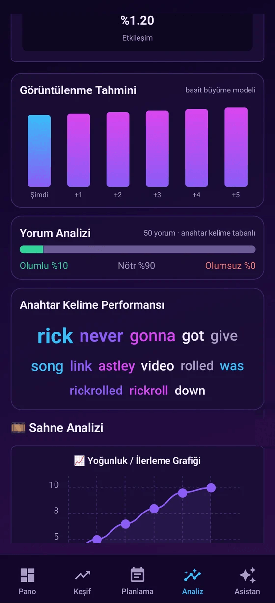
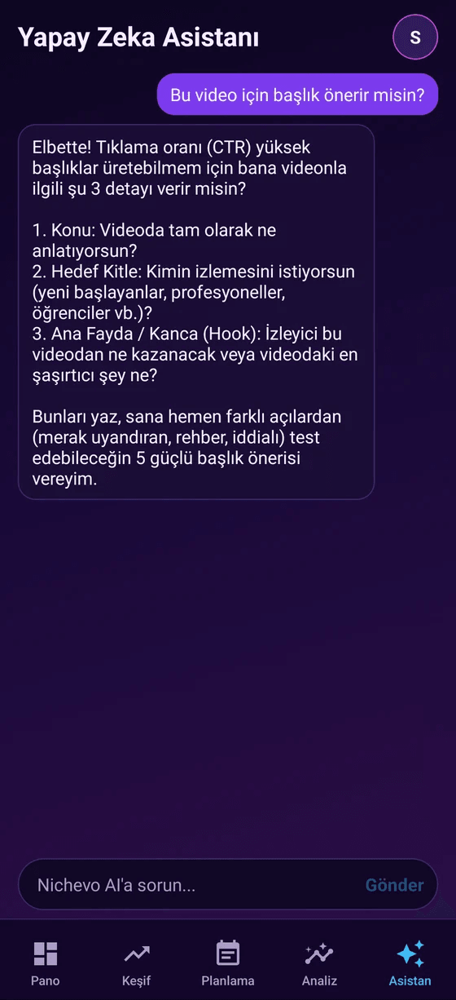
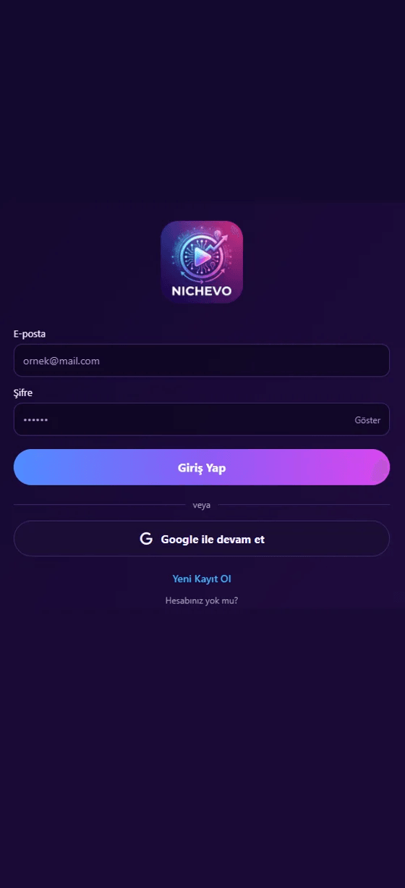

# Nichevo

YouTube içerik üreticileri için niş keşfi, rekabet haritası, video analizi ve içerik planlama uygulaması. Android uygulaması ve web sürümü aynı kod tabanından çıkar.

> Eski adı "Fatihgo Analysis Mobile". Repo adı ve belgeler Nichevo'ya taşındı.

- **Web:** https://nichevo.fatihgo.com
- **Tanıtım sayfası:** https://fatihgo.com/uygulamalar/nichevo
- **Hesap sunucusu:** `https://nichevo-api.fatihgo.com` (`GET /healthz`)
- **Geliştirici:** [fatihgo.com](https://fatihgo.com)
- **Lisans:** MIT

## Ekran görüntüleri

Görüntüler Android uygulamasından alındı; Pano ve Keşif'teki veriler gerçek YouTube verisidir (Türkiye, 18 Ekim 2026).

| Pano | Keşif | Planlama |
|:---:|:---:|:---:|
|  |  |  |

| Video analizi | Tahmin ve yorumlar | Asistan | Giriş |
|:---:|:---:|:---:|:---:|
|  |  |  |  |

## Ne yapar

Uygulamanın beş sekmesi var:

| Sekme | İş |
|---|---|
| **Pano** | Türkiye'de öne çıkan konular, kanal skoru (0-100), büyüme ipucu ve **niş × format rekabet ısı haritası** |
| **Keşif** | **Yükselen nişler** ve kanal taraması: arama terimi, kanal yaşı, abone aralığı, aykırı değer eşiği; her kanalda abone, izlenme, yaş ve izlenme/abone oranı |
| **Planlama** | Haftalık takvim, fikir oluşturucu ve nişini ile konunu verince 6 aşamalı çekim planı (PDF olarak paylaşılır) |
| **Analiz** | YouTube bağlantısından video analizi: izlenme, beğeni, etkileşim, görüntülenme tahmini, yorumların duygu dağılımı, anahtar kelime performansı, sahne yoğunluğu |
| **Asistan** | Seçtiğin yapay zekâ sağlayıcısıyla sohbet |

Hesap: e-posta ve şifreyle ya da **Google ile giriş**; tarayıcıda ve telefonda aynı hesap. Arayüz şu an yalnızca Türkçe (profildeki dil tercihi kaydedilir, çeviri yok).

### Canlı veri nasıl hesaplanıyor

İkisi de YouTube Data API `search.list` sonuçlarındaki yaklaşık video sayısından (`pageInfo.totalResults`) çıkar. Kodu `lib/market.ts`, testleri `tests/market.test.ts`.

- **Rekabet ısı haritası:** teknoloji, oyun, eğitim ve yaşam nişlerinin kısa (4 dk altı), uzun (20 dk üstü), biten canlı yayın, podcast ve vlog formatlarında **son 30 günde yüklenen video sayısı**. Değerler logaritmik ölçekte 0-1'e indirgenir; mavi az, magenta yoğun rekabettir.
- **Yükselen nişler:** altı izlenen nişin son dört haftadaki **haftalık yükleme hacmi** ve ilk-son hafta değişimi. Bu yükleme hacminin artışıdır, izleyici talebinin artışı demek değildir.
- **Kota:** 44 arama = yaklaşık **4.400 kota birimi**; sonuçlar 24 saat önbelleğe alınır. Kota dolarsa son hesaplanan veri gösterilir. Anahtar yoksa ekranlar "Örnek veri" etiketiyle örnek içerik gösterir, sahte kanal üretmez.

## Nasıl kullanılır

1. **Hesap aç ve giriş yap.** E-posta, ad ve şifre (en az 8 karakter) ya da "Google ile devam et".
2. **Kanalını bağla (isteğe bağlı).** Karşılama ekranında `@kullaniciadi` ya da kanal bağlantısı; "Şimdilik atla" ile geçip sonradan **Profil ve Ayarlar → Kanal Bilgileri**'nden eklenebilir.
3. **YouTube anahtarını ekle.** **Profil ve Ayarlar → YouTube Data API v3** altına kendi anahtarını gir. Anahtar yokken Pano ve Keşif örnek veriyle, Analiz hiç çalışmaz.
4. **Yapay zekâ sağlayıcını seç (isteğe bağlı).** Asistan, fikir oluşturucu ve çekim planı için sağlayıcıyı, modeli ve anahtarını ayarlardan seç. Sağlayıcı yoksa fikirler ve plan kalıp olarak gelir ve ekran bunu söyler.
5. **Kullan:** Pano'da konulara ve ısı haritasına bak, Keşif'te yükselen bir nişe dokunup taramayı başlat, Planlama'da çekim planı çıkar, Analiz'e bir video bağlantısı yapıştır.

## Yapay zekâ sağlayıcıları

Sağlayıcıyı ve modeli ayarlardan sen seçersin; anahtarlar sunucuya gönderilmez, cihazda kalır (Android Keystore / iOS Keychain; web'de tarayıcı deposu). 14 sağlayıcı kayıtlı (`lib/ai-providers.ts`):

- **Ücretsiz katmanı olanlar:** Google Gemini, Groq, OpenRouter, NVIDIA NIM, Mistral
- **Ücretli:** Anthropic Claude, OpenAI, Kimi (Moonshot), xAI Grok
- **Yerel ağ:** Ollama, LM Studio (anahtarsız, ağdaki bilgisayarda)
- **Diğer:** EVREN LLM, Alibaba Qwen (Model Studio), OpenAI uyumlu özel adres

> Web sürümünde istekler doğrudan tarayıcıdan gider; bazı sağlayıcılar tarayıcı kaynaklı (CORS) çağrıları engelleyebilir ve `http://` yerel adreslere HTTPS sayfadan erişilemez. Bu kısıtlar web sürümünde sağlayıcı bazında denenmedi; Android'de bu kısıt yoktur.

## Mimari

```
Uygulama (Expo / React Native, web + Android)
   │  hesap: kayıt, giriş, Google, jeton yenileme
   ▼
nichevo-backend (Fastify 5 + Postgres)  →  https://nichevo-api.fatihgo.com
```

- **İstemci:** Expo SDK 54, React Native 0.81, expo-router, NativeWind. Web sürümü `expo export --platform web` ile statik üretilir ve Cloudflare Pages'ten yayınlanır.
- **Hesap sunucusu:** `nichevo-backend/`. Yalnızca hesabı tutar; YouTube ve yapay zekâ çağrıları cihazdan doğrudan yapılır. Ayrıntı: [`nichevo-backend/README.md`](nichevo-backend/README.md).
- **Google ile giriş:** sunucu tarafı yetkilendirme kodu akışı. İstemci tarayıcıyı açar, kod değişimi ve kimlik doğrulaması sunucuda yapılır; Google gizli anahtarı cihaza inmez. Aynı e-postayla şifreli hesap varsa ele geçirmeyi önlemek için hesaplar birleştirilmez.

## Geliştirme

Gereksinimler: Node 22+, Android için JDK 17.

```bash
pnpm install

# Uygulama (web önizleme, 8081)
npx expo start --web

# Hesap sunucusu
cd nichevo-backend
npm install
npm run migrate
npm start            # 127.0.0.1:3102

# Testler
pnpm test                         # uygulama
cd nichevo-backend && npm test    # sunucu (gerçek Postgres gerekir)
```

Uygulama hangi sunucuya bağlanacağını **derleme anında** `EXPO_PUBLIC_API_URL` ile öğrenir. Verilmezse uygulama yerel modda açılır ve şifre doğrulanmaz. Expo, uygulama kökündeki `.env` dosyasını da okur; yerel modu denemek için `EXPO_NO_DOTENV=1` ve `--clear` kullan.

### Google ile giriş kurulumu

Google Cloud Console'da **Web uygulaması** türünde bir OAuth istemcisi oluştur ve yetkili yönlendirme URI'si olarak `<PUBLIC_URL>/v1/auth/google/callback` adresini ekle. `nichevo-backend/.env` içine `GOOGLE_CLIENT_ID`, `GOOGLE_CLIENT_SECRET` ve `PUBLIC_URL` yaz (örnek: `.env.example`). Üçü tanımlı değilse Google düğmesi uygulamada görünmez.

OAuth izin ekranı "Testing" durumundayken yalnızca listedeki test kullanıcıları giriş yapabilir; herkese açmak için izin ekranını yayına almak gerekir (kapsamlar `openid email profile`, hassas değil).

### Web derlemesi ve yayın

```bash
EXPO_PUBLIC_API_URL=https://nichevo-api.fatihgo.com npx expo export --platform web --clear --output-dir dist
node scripts/web-fix-assets.mjs dist       # ikon yazı tiplerini assets/vendor'a taşır (aşağıya bak)
npx wrangler pages deploy dist --project-name nichevo --branch main
```

`web-fix-assets.mjs` gerekli: Expo ikon yazı tiplerini `assets/node_modules/...` altına koyar, Cloudflare Pages `node_modules` klasörlerini yüklemez ve o adresler HTML'e düşüp ikonları görünmez yapar. Wrangler'ı başka bir projenin `functions/` klasörünün olduğu dizinden çalıştırma, o klasör pakete girer.

Sunucu yalnızca `https://nichevo.fatihgo.com` ve yerel geliştirme adreslerinden gelen tarayıcı isteklerine CORS izni verir (`nichevo-backend/src/app.ts`).

### Android

```bash
EXPO_PUBLIC_API_URL=https://nichevo-api.fatihgo.com
cd android && ./gradlew :app:createBundleReleaseJsAndAssets --rerun assembleRelease   # JDK 17
```

Paket adı `com.fatihkunak.nichevo`. Gradle `EXPO_PUBLIC_*` değişikliklerini önbellekte izlemediği için JS paketi `--rerun` ile yeniden üretilir.

## Gizlilik

- API anahtarların cihazında kalır.
- Sunucu yalnızca e-posta, ad, kanal adı ve şifre özetini (scrypt) ya da Google hesap kimliğini tutar. Hesabını uygulamadan silebilirsin.
- Ayrıntı: [fatihgo.com gizlilik politikası](https://fatihgo.com/uygulamalar/nichevo/gizlilik).

## Lisans

[MIT](LICENSE) © 2026 Fatih Kunak
