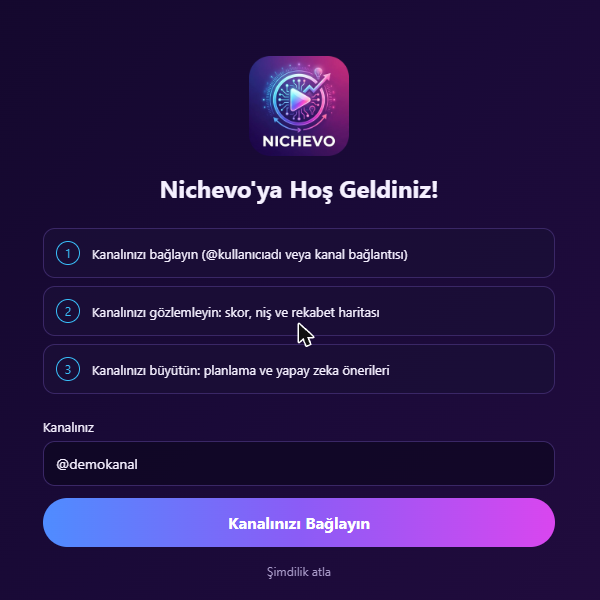
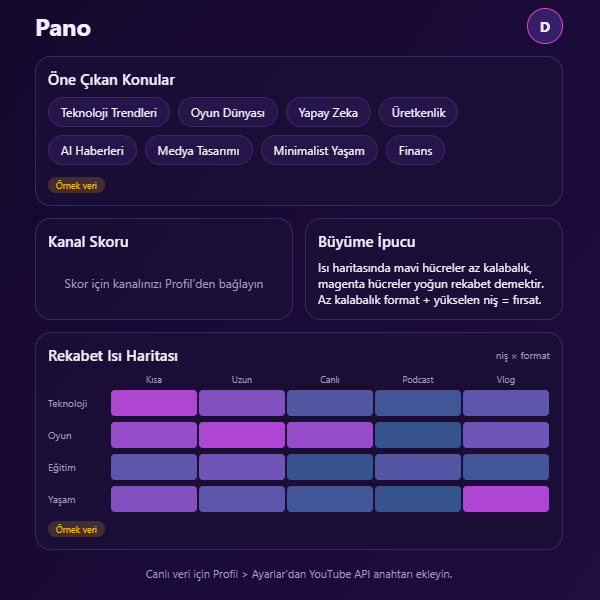
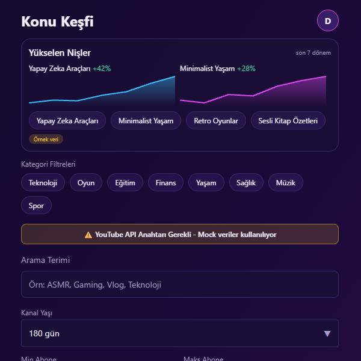
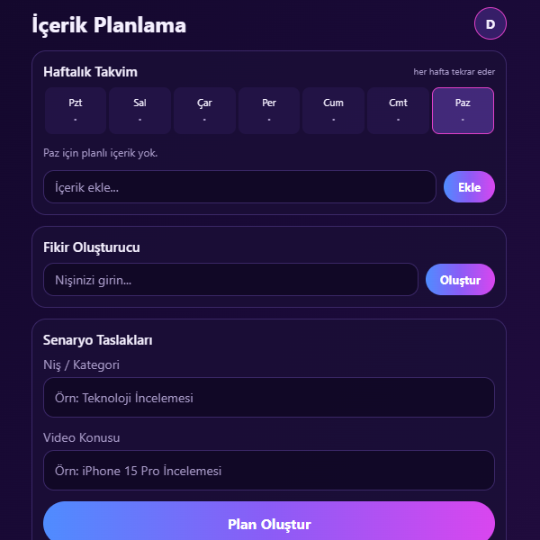
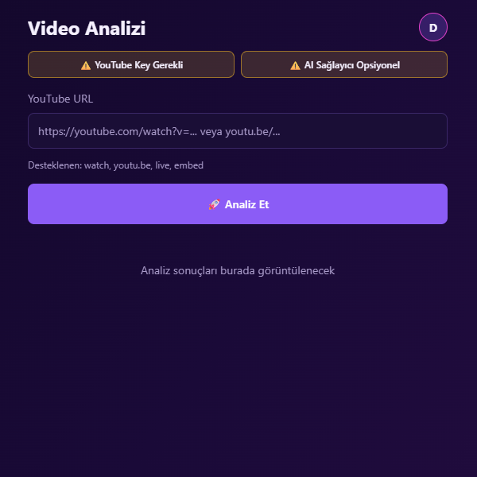
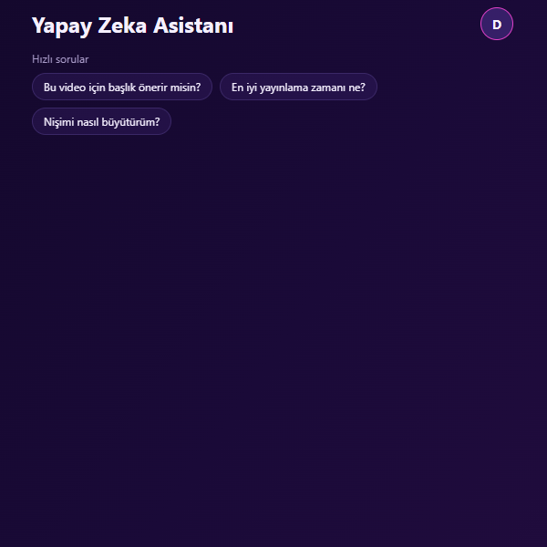

# Nichevo

YouTube içerik üreticileri için niş keşfi, video analizi ve içerik planlama uygulaması. Android uygulaması ve web sürümü aynı kod tabanından çıkar.

> Eski adı "Fatihgo Analysis Mobile". Repo adı ve belgeler Nichevo'ya taşındı.

- **Web:** https://nichevo.fatihgo.com
- **Hesap sunucusu:** `https://nichevo-api.fatihgo.com` (`GET /healthz`)
- **Geliştirici:** [fatihgo.com](https://fatihgo.com)
- **Lisans:** MIT

## Ekran görüntüleri

Görüntüler web sürümünden, hesapsız yerel modda alındı. YouTube anahtarı girilmediği için Pano ve Keşif'te "Örnek veri" etiketli örnek içerik görünür; anahtarı ekleyince canlı veri gelir.

| Karşılama | Pano | Keşif |
|:---:|:---:|:---:|
|  |  |  |

| Planlama | Analiz | Asistan |
|:---:|:---:|:---:|
|  |  |  |

## Ne yapar

Uygulamanın beş sekmesi var:

| Sekme | İş |
|---|---|
| **Pano** | Öne çıkan konular, kanal skoru, büyüme ipucu ve niş × format rekabet ısı haritası |
| **Keşif** | YouTube kanallarında niş taraması: abone sayısı ve kanal yaşı filtresi, aykırı değer (outlier) tespiti, tablo görünümü |
| **Planlama** | Niş ve konu seçerek video planı çıkarır |
| **Analiz** | YouTube bağlantısından video analizi: görüntülenme, beğeni, etkileşim, yoğunluk ve içerik grafikleri |
| **Asistan** | Seçtiğin yapay zekâ sağlayıcısıyla sohbet |

Ayrıca hesap (kayıt, giriş, profil, şifre değiştirme, hesap silme) ve Türkçe/İngilizce dil seçimi vardır.

## Nasıl kullanılır

1. **Hesap aç ve giriş yap.** Kayıt ekranında ad, e-posta, isteğe bağlı kanal adı ve şifre girersin (şifre en az 8 karakter).
2. **Kanalını bağla (isteğe bağlı).** Karşılama ekranında `@kullaniciadi` ya da kanal bağlantısını yazarsın; "Şimdilik atla" ile geçip sonradan **Profil ve Ayarlar → Kanal Bilgileri**'nden de ekleyebilirsin.
3. **YouTube anahtarını ekle.** **Profil ve Ayarlar → YouTube Data API v3** altına kendi anahtarını girersin. Anahtar yokken Pano ve Keşif örnek veriyle çalışır, Analiz çalışmaz.
4. **Yapay zekâ sağlayıcını seç (isteğe bağlı).** Asistan ve yapay zekâ önerileri için sağlayıcıyı, modeli ve anahtarını ayarlardan seçersin. Anahtarsız kullanılabilen tek seçenek yerel ağdaki Ollama / LM Studio'dur.
5. **Kullan.**
   - *Pano:* günün öne çıkan konularına ve rekabet ısı haritasına bak.
   - *Keşif:* kategori seç, arama terimi, kanal yaşı ve abone aralığı ver; yükselen nişleri ve aykırı değerleri gör.
   - *Planlama:* haftalık takvime içerik ekle, fikir oluşturucudan öneri al, niş ve konudan video planı çıkar.
   - *Analiz:* bir YouTube bağlantısı yapıştır (`watch`, `youtu.be`, `live`, `embed`), görüntülenme, beğeni ve etkileşimi gör.
   - *Asistan:* "Bu video için başlık önerir misin?" gibi hızlı sorulardan başla ya da kendi sorunu yaz.

**Profil ve Ayarlar**'dan dili (Türkçe / İngilizce), bildirimleri ve paketini yönetir, çıkış yaparsın.

## Yapay zekâ sağlayıcıları

Sağlayıcıyı ve modeli ayarlardan sen seçersin; anahtarlar sunucuya gönderilmez, cihazda kalır (Android Keystore / iOS Keychain; web'de tarayıcı deposu). 14 sağlayıcı kayıtlı (`lib/ai-providers.ts`):

- **Ücretsiz katmanı olanlar:** Google Gemini, Groq, OpenRouter, NVIDIA NIM, Mistral
- **Ücretli:** Anthropic Claude, OpenAI, Kimi (Moonshot), xAI Grok
- **Yerel ağ:** Ollama, LM Studio (anahtarsız, ağdaki bilgisayarda)
- **Diğer:** EVREN LLM, Alibaba Qwen (Model Studio), OpenAI uyumlu özel adres

Video ve kanal verisi için kendi **YouTube Data API v3** anahtarını girersin.

> Web sürümünde istekler doğrudan tarayıcıdan gider; bazı sağlayıcılar tarayıcı kaynaklı (CORS) çağrıları engelleyebilir ve `http://` yerel adreslere HTTPS sayfadan erişilemez. Bu kısıtlar web sürümünde sağlayıcı bazında denenmedi; sorunsuz çalışması gereken yer Android uygulamasıdır.

## Mimari

```
Uygulama (Expo / React Native, web + Android)
   │  hesap: kayıt/giriş/jeton yenileme
   ▼
nichevo-backend (Fastify 5 + Postgres)  →  https://nichevo-api.fatihgo.com
```

- **İstemci:** Expo SDK 54, React Native 0.81, expo-router, NativeWind. Web sürümü `expo export --platform web` ile statik üretilir ve Cloudflare Pages'ten yayınlanır.
- **Hesap sunucusu:** `nichevo-backend/`. Yalnızca hesabı tutar; YouTube ve yapay zekâ çağrıları cihazdan doğrudan yapılır. Ayrıntı: [`nichevo-backend/README.md`](nichevo-backend/README.md).

## Geliştirme

Gereksinimler: Node 22+, Android için JDK 17.

```bash
pnpm install

# Uygulama (web önizleme, 8081)
npx expo start --web

# Hesap sunucusu
cd nichevo-backend
npm install
npm run migrate
npm start            # 127.0.0.1:3102

# Testler
pnpm test                         # uygulama
cd nichevo-backend && npm test    # sunucu (gerçek Postgres gerekir)
```

Uygulama hangi sunucuya bağlanacağını **derleme anında** `EXPO_PUBLIC_API_URL` ile öğrenir. Verilmezse uygulama yerel modda açılır ve şifre doğrulanmaz.

### Web derlemesi ve yayın

```bash
EXPO_PUBLIC_API_URL=https://nichevo-api.fatihgo.com npx expo export --platform web --output-dir dist
npx wrangler pages deploy dist --project-name nichevo --branch main
```

Sunucu yalnızca `https://nichevo.fatihgo.com` ve yerel geliştirme adreslerinden gelen tarayıcı isteklerine CORS izni verir (`nichevo-backend/src/app.ts`).

### Android

```bash
EXPO_PUBLIC_API_URL=https://nichevo-api.fatihgo.com
cd android && ./gradlew assembleRelease     # JDK 17
```

Paket adı `com.fatihkunak.nichevo`.

## Gizlilik

- API anahtarların cihazında kalır.
- Sunucu yalnızca e-posta, ad, kanal adı ve şifre özetini (scrypt) tutar. Hesabını uygulamadan silebilirsin.

## Lisans

[MIT](LICENSE) © 2026 Fatih Kunak
